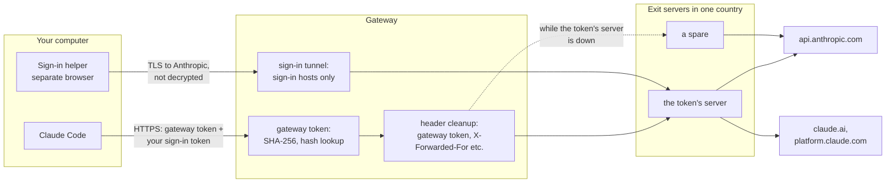
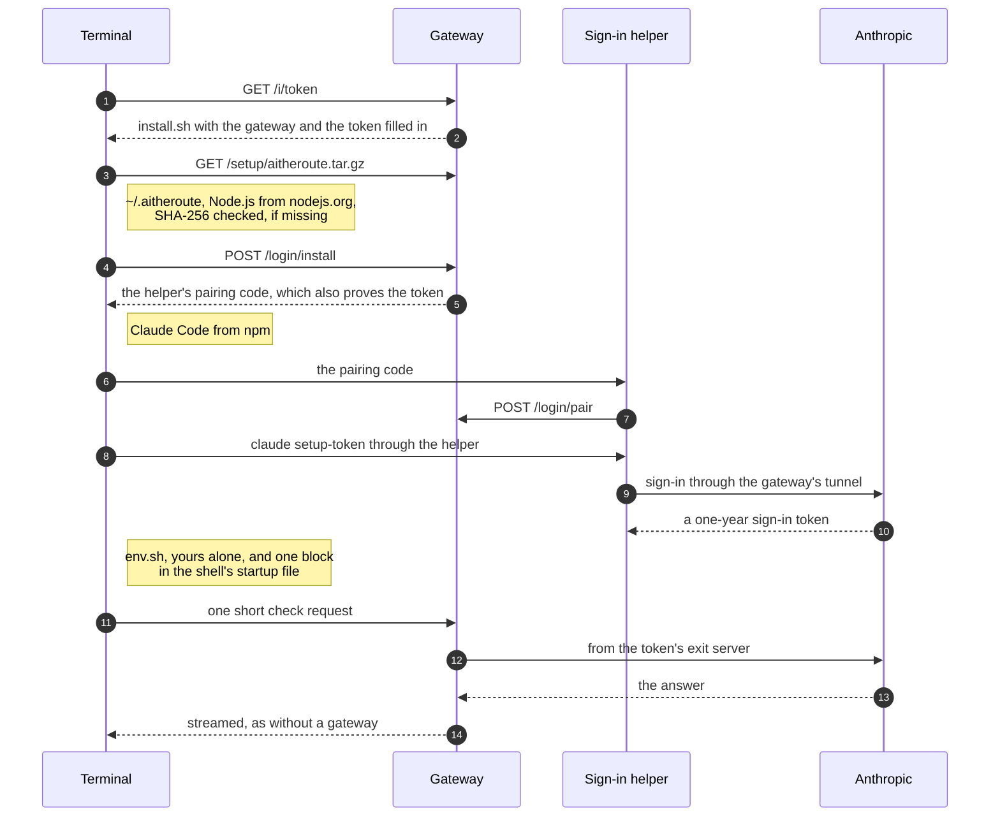

<div align="center">

# Claude Code behind a gateway: a breakdown and an open client

Where Claude Code goes on the network, how to bring all of its traffic to one
point, and how the client and the server are built for that.

[](https://github.com/Romaxa55/aitheroute-client/actions/workflows/test.yml)
[](LICENSE)


[Русская версия](README.md) · [Where Claude Code goes](#where-claude-code-goes) ·
[How it works](#how-it-works) · [The server](#the-server) ·
[Try it](#try-it)

</div>

`ANTHROPIC_BASE_URL` moves only the model requests to a gateway. Signing in,
refreshing the token, telemetry, feature flags and Claude Code's own checks go
direct, from your address. This repository explains how to bring all of that
to one point and holds an open client that does it: an installer and a sign-in
helper. It is plain Node.js and shell, so you can read every step before you
run it. The only binaries it fetches are Node.js from nodejs.org (SHA-256
checked) when yours is missing or older than 24.5, and Claude Code from npm
when you have none of your own, both as published.

The server's code is closed. [Below](#the-server) it is described in words and
a diagram, and [`docs/gateway.md`](docs/gateway.md) has everything you need to
write your own.

AI The Route is not affiliated with Anthropic. Claude and Claude Code are
Anthropic's products.

## Where Claude Code goes

From Claude Code's documentation
([network-config](https://code.claude.com/docs/en/network-config),
[authentication](https://code.claude.com/docs/en/authentication)):

| What                                              | Where                              | Through `ANTHROPIC_BASE_URL` |
| ------------------------------------------------- | ---------------------------------- | ---------------------------- |
| model requests                                    | `api.anthropic.com`                | yes                          |
| WebFetch's domain check, feature flags, telemetry | `api.anthropic.com`                | no                           |
| signing in, exchanging and refreshing the token   | `claude.ai`, `platform.claude.com` | no                           |
| updates, the plugin marketplace                   | `downloads.claude.ai`              | no                           |
| the changelog at an interactive start             | `raw.githubusercontent.com`        | no                           |

Claude Code's own settings close the background traffic:
`CLAUDE_CODE_DISABLE_NONESSENTIAL_TRAFFIC=1`,
`CLAUDE_CODE_DISABLE_OFFICIAL_MARKETPLACE_AUTOINSTALL=1` and
`skipWebFetchPreflight`. Measured with Claude Code 2.1.332 behind a proxy that
let nothing out, a session (not the first run) with them opened nothing but the
gateway. Without the first flag it went to `api.anthropic.com` 12 times, and to
`raw.githubusercontent.com` and `downloads.claude.ai`
([`docs/setup.md`](docs/setup.md)). These settings leave signing in alone; the
sign-in helper here is for that.

## How it works



1. Claude Code sends its requests to the gateway (`ANTHROPIC_BASE_URL`) with
   the gateway token in a header and your own Claude sign-in token.
2. The gateway checks the gateway token, removes it and the headers that tell
   where a request came from, and passes the rest on as it is from a server in
   the token's country. It is always the same server; another one in that
   country takes the requests while it is down or once it has been replaced.
3. The sign-in helper opens Claude's sign-in page in a separate browser profile
   that reaches the internet only through the gateway, so you sign in from the
   same place your requests come from.

## The client

### What the install command does

On Windows, `/win` and `.zip`:



Your settings are saved only once the sign-in token is in hand (the only
settings it changes before that are Claude Code's two flags below), so a run
that stops halfway leaves an earlier working setup as it was.
[`docs/setup.md`](docs/setup.md) describes the whole chain and the reasons
behind each choice.

### What it changes on your computer

- `~/.aitheroute/`, readable by you alone: `setup/` (the installer), `helper/`
  (the sign-in helper), `node/` and `claude/` (only if they were missing),
  `env.sh` (your settings, the tokens among them).
- One marked block in your shell's startup file (`# >>> AI The Route >>>`) that
  loads `env.sh`; on Windows, user environment variables instead, and the
  folder of the Claude Code it installed in your `Path`.
- Claude Code's own first-run flags: `hasCompletedOnboarding` in
  `~/.claude.json` and `skipWebFetchPreflight` in `~/.claude/settings.json`.

Claude Code's files are never modified: it is installed from npm as
published, and nothing outside your user account is touched.

### The leak guard (optional)

Variables from the shell's startup file reach only a terminal that loaded them.
An editor started from the Dock, fish or cron does not see them, and Claude
Code would go direct. The setup offers the guard at the end (default no), and
you can turn it on or off at any time:

```sh
sh ~/.aitheroute/start.sh protect on    # or off, status
```

```powershell
~\.aitheroute\start.cmd protect on      # Windows PowerShell
```

It writes the gateway's address and the flags into Claude Code's own settings
(`~/.claude/settings.json`), so Claude Code goes through the gateway however it
was started. If you agree and grant administrator rights, it also closes
Anthropic's direct addresses (claude.ai, api.anthropic.com and a few others) to
every program through the hosts file. Docs, support and claude.com stay open,
and the sign-in through the helper works as before. `protect off` undoes both.

### Where it works and what it needs

- Claude Code in a terminal, including the terminal inside VS Code, Cursor and
  JetBrains IDEs. The Claude Desktop app is not supported: signed in to a
  Claude account, it connects to Anthropic directly, around the gateway.
- A Claude subscription that includes Claude Code.
- For the sign-in: Google Chrome, Chromium or Microsoft Edge on macOS; Google
  Chrome or Microsoft Edge on Windows. On Linux the helper runs the sign-in in
  an isolated session, which needs a few system packages and Claude Code
  installed under `/usr` (see [`docs/login-client.md`](docs/login-client.md)).
  On a Linux server without a desktop, run the setup on your Mac or Windows
  computer first and paste its sign-in token on the server when asked.
- macOS, Linux or Windows on x64 or arm64.

### Removing it

Turn the leak guard off first if you turned it on, then delete `~/.aitheroute`;
the block in your shell's startup file then does nothing, delete it when you
like. Folder deleted with the guard still on? Then take it out by hand:
`ANTHROPIC_BASE_URL` and the two `CLAUDE_CODE_DISABLE_*` flags from `env` in
`~/.claude/settings.json`, and the `# >>> AI The Route leak guard >>>` block
from the hosts file (that needs administrator rights). On Windows also delete
the user variables `ANTHROPIC_BASE_URL`, `ANTHROPIC_CUSTOM_HEADERS`,
`CLAUDE_CODE_OAUTH_TOKEN`, `CLAUDE_CODE_DISABLE_NONESSENTIAL_TRAFFIC` and
`CLAUDE_CODE_DISABLE_OFFICIAL_MARKETPLACE_AUTOINSTALL`, and the
`C:\Users\<you>\.aitheroute\claude` entry
(`%USERPROFILE%\.aitheroute\claude`) in `Path`, there if the setup installed
Claude Code. Claude Code's two first-run flags stay; they are harmless
([`docs/setup.md`](docs/setup.md#removing-it) says how to drop them).

## The server

The server's code is closed: it runs the service and holds its keys. This is
what it does with a model request:

1. **The pass.** It computes the SHA-256 of the gateway token and looks the hash
   up. A token that is unknown, expired or revoked gets `403` (not `401`:
   Claude Code retries a `401` for minutes), and nothing goes to Anthropic. The
   token itself is never stored, only its hash and first characters. After 20
   failures from one address in 10 minutes, `429`.
2. **The headers.** It removes the gateway token, the hop-by-hop headers and
   `Forwarded`, `X-Forwarded-For`, `X-Real-IP` and the like. Everything else,
   your `Authorization` among it, is passed on as it is, unread.
3. **The destination** is fixed: `https://api.anthropic.com`, its certificate
   checked.
4. **The exit.** The request leaves from an exit server in the token's
   country, always the same one for one person. Each server is checked twice
   every 30 s; one that has not answered for a minute is taken out, and an
   hourly run replaces dead ones with new ones from the same country. With none
   alive the answer is `502`, never a request from the gateway's own address.
5. **Streaming.** The body and the answer are relayed as they come, without
   buffering or parsing.

The gateway does not decrypt the sign-in tunnel: TLS runs from the helper's
browser to Anthropic, the gateway sees only the host name, the time and the
amount of traffic, and lets through sign-in hosts only. The proxy's log holds
the time, the token's id (not the token), the client's address, the pool, the
method, the path without its query, the status and the duration; headers,
prompts and answers stay out of it. [PRIVACY.md](PRIVACY.md) lists everything
kept.

Want your own? [`docs/gateway.md`](docs/gateway.md) describes every route the
installer and the helper call, what they expect back and what a home-made
gateway would trip on. The smallest gateway is the API pass-through alone; then
you set Claude Code's variables by hand and need neither the installer nor the
helper.

## The trust boundary

- TLS from Claude Code ends at the gateway; otherwise it could not read its
  token. While a request is forwarded, your authorization header is in the
  process's memory, as in any proxy. Nobody can prove from outside that nothing
  else runs on someone else's server.
- The one-year token from `claude setup-token` goes through the gateway in
  every request. Treat it as a password.
- Anthropic's
  [rule on credentials](https://code.claude.com/docs/en/legal-and-compliance#authentication-and-credential-use)
  does not permit third-party developers to route their users' requests
  through Free, Pro, Max or Ultra plan credentials, or to collect, store or
  intermediate Claude.ai credentials or session tokens. With an API key, a
  gateway in front of Claude Code is a documented setup
  ([LLM gateway](https://code.claude.com/docs/en/llm-gateway)). Read the rule
  before you choose a gateway, yours or someone else's.

## Try it

You need a gateway and a token for it. No gateway of your own? Access to mine
is in the Telegram bot [@aitheroute_bot](https://t.me/aitheroute_bot): it sends
a command with your token already in it. A gateway of your own serves the
command at the same `/i/<token>`.

1. Run the command in a terminal:

   ```sh
   # macOS, Linux
   curl -fsSL https://<gateway>/i/<token>/en | sh
   ```

   ```powershell
   # Windows PowerShell
   irm https://<gateway>/i/<token>/win/en | iex
   ```

   Rather not pipe a script into a shell? Download the archive
   (`https://<gateway>/setup/aitheroute.zip`), unpack it, run `sh start.sh`
   (macOS, Linux) or double-click `start.cmd` (Windows) and paste the command
   when asked. It is the same code as in [`clients/setup`](clients/setup).

2. Sign in to your Claude account in the window the helper opens. The setup
   sends one short request to check, then says it is done.
3. Run `claude` in your project's folder.

It installs Node.js and Claude Code if they are missing. No administrator
rights are needed. Running it again updates the Claude Code it installed and
keeps a sign-in that works.

## Security notes

- The command contains your token, so it stays in your shell's history, and on
  a shared Linux machine other users can see it in `ps` while `curl` runs.
  Reissuing the token ends both. The archive asks for the command instead, so
  that way leaves no history.
- `~/.aitheroute/env.sh` is written as a new file only you can read.
- Your Claude sign-in token gives access to your subscription: do not share it.
- Found a security problem? See [SECURITY.md](SECURITY.md): write to us
  rather than opening a public issue.

## Repository layout

| Path                                   | What                                                           |
| -------------------------------------- | -------------------------------------------------------------- |
| `clients/setup/install.sh`, `.ps1`     | the first stage the gateway serves, with its address filled in |
| `clients/setup/bundle/`                | `start.sh`, `start.ps1`, `start.cmd` and the archive's README  |
| `clients/setup/*.mjs`                  | the setup itself; messages in `ru.json` and `en.json`          |
| `clients/login/`                       | the sign-in helper                                             |
| `apps/proxy/src/login/client-hello.ts` | the one file the helper shares with the gateway                |
| `docs/`                                | how the setup, the helper and a gateway work                   |

## Tests

Node.js 24.5 or newer, no dependencies to install:

```sh
node --test clients/setup/test/*.test.mjs     # macOS, Linux
node --test clients/login/test/*.test.mjs     # Linux, where the helper's isolated session runs
```

## Contributing

Issues and pull requests are welcome. Before your first commit, turn on the
hook that refuses a commit carrying a secret (it needs
[gitleaks](https://github.com/gitleaks/gitleaks)):

```sh
git config core.hooksPath .githooks
```

CI runs the same scan over every commit.

## License

[MIT](LICENSE).
