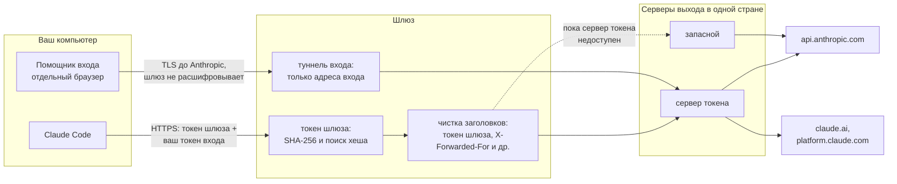
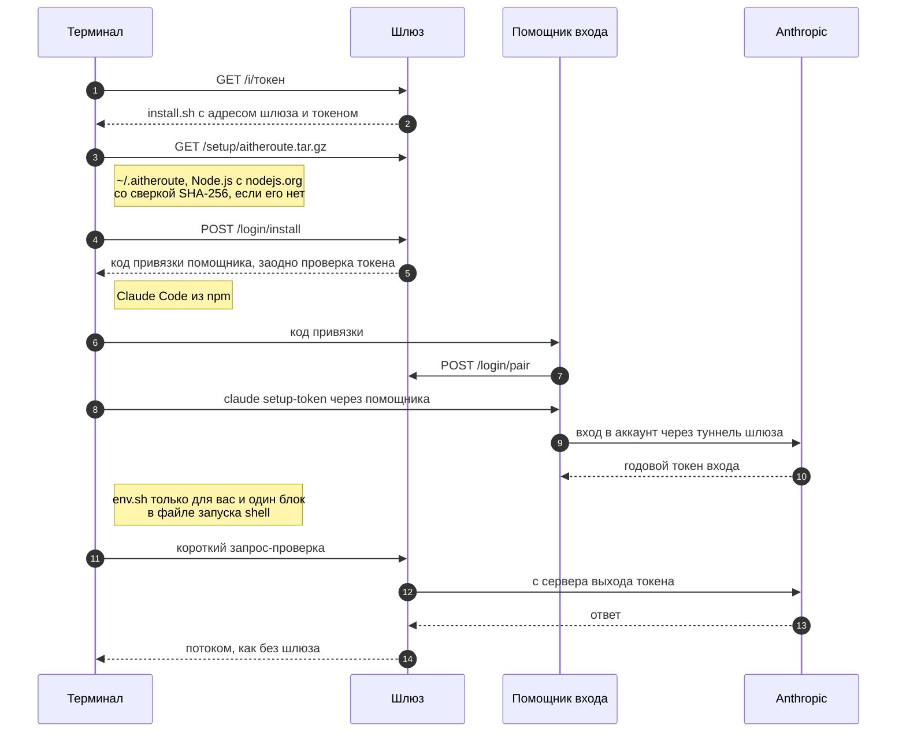

<div align="center">

# Claude Code за шлюзом: разбор и открытый клиент

Куда Claude Code ходит в сеть, как собрать весь его трафик в одну точку и как
для этого устроены клиент и сервер.

[](https://github.com/Romaxa55/aitheroute-client/actions/workflows/test.yml)
[](LICENSE)


[English](README.en.md) · [Куда ходит Claude Code](#куда-ходит-claude-code) ·
[Как это устроено](#как-это-устроено) · [Сервер](#сервер) ·
[Попробовать](#попробовать)

</div>

`ANTHROPIC_BASE_URL` уводит на шлюз только запросы к модели. Вход в аккаунт,
обновление токена, телеметрия, флаги функций и служебные проверки Claude Code
идут напрямую, с вашего адреса. Здесь разобрано, как вывести всё это через одну
точку, и лежит открытый клиент, который так и делает: установщик и помощник
входа. Это обычный Node.js и shell: каждый шаг можно прочитать до запуска. Из
бинарников клиент скачивает только Node.js с nodejs.org (со сверкой SHA-256),
если его нет или он старше 24.5, и Claude Code из npm, если своего нет, — оба
в том виде, в каком они опубликованы.

Код сервера закрыт. Как он устроен, описано [ниже](#сервер) схемами и словами,
а в [`docs/gateway.md`](docs/gateway.md) — всё, что нужно, чтобы написать свой.

AI The Route не связан с Anthropic. Claude и Claude Code принадлежат Anthropic.

## Куда ходит Claude Code

По документации Claude Code
([network-config](https://code.claude.com/docs/en/network-config),
[authentication](https://code.claude.com/docs/en/authentication)):

| Что                                                  | Куда                               | Через `ANTHROPIC_BASE_URL` |
| ---------------------------------------------------- | ---------------------------------- | -------------------------- |
| запросы к модели                                     | `api.anthropic.com`                | да                         |
| проверка доменов WebFetch, флаги функций, телеметрия | `api.anthropic.com`                | нет                        |
| вход в аккаунт, обмен и обновление токена            | `claude.ai`, `platform.claude.com` | нет                        |
| обновления, маркетплейс плагинов                     | `downloads.claude.ai`              | нет                        |
| список изменений при интерактивном запуске           | `raw.githubusercontent.com`        | нет                        |

Фоновый трафик закрывают штатные настройки Claude Code:
`CLAUDE_CODE_DISABLE_NONESSENTIAL_TRAFFIC=1`,
`CLAUDE_CODE_DISABLE_OFFICIAL_MARKETPLACE_AUTOINSTALL=1` и
`skipWebFetchPreflight`. С ними, по замеру на Claude Code 2.1.332 за прокси,
который ничего не выпускал, сессия (не первый запуск) не открыла ничего, кроме
шлюза. Без первого флага она 12 раз обратилась к `api.anthropic.com`, а также к
`raw.githubusercontent.com` и `downloads.claude.ai`
([`docs/setup.md`](docs/setup.md)). Вход в аккаунт эти настройки не трогают:
для него здесь помощник входа.

## Как это устроено



1. Claude Code отправляет запросы на шлюз (`ANTHROPIC_BASE_URL`) с токеном
   шлюза в заголовке и вашим собственным токеном входа Claude.
2. Шлюз проверяет токен шлюза, вырезает его и заголовки, по которым видно,
   откуда пришёл запрос, и передаёт остальное как есть с сервера в стране
   токена. Сервер всегда один и тот же; другой сервер той же страны берёт
   запросы, пока этот недоступен или после того, как его заменили.
3. Помощник входа открывает страницу входа Claude в отдельном профиле
   браузера, который выходит в интернет только через шлюз: вы входите оттуда
   же, откуда идут ваши запросы.

## Клиент

### Что делает команда установки

На Windows — `/win` и `.zip`:



Настройки сохраняются только тогда, когда токен входа уже получен (до этого из
настроек меняются только два флага Claude Code, о них ниже): запуск, прерванный
на середине, оставляет прежнюю рабочую настройку как была. Вся цепочка и причины каждого
решения описаны в [`docs/setup.md`](docs/setup.md) (на английском).

### Что меняется на компьютере

- `~/.aitheroute/`, доступная только вам: `setup/` (установщик), `helper/`
  (помощник входа), `node/` и `claude/` (только если их не было), `env.sh`
  (ваши настройки, в том числе токены).
- Один помеченный блок в файле запуска вашего shell (`# >>> AI The Route >>>`),
  который подключает `env.sh`; на Windows вместо этого переменные пользователя
  и, если настройка ставила Claude Code, его папка в `Path`.
- Флаги первого запуска Claude Code: `hasCompletedOnboarding` в `~/.claude.json`
  и `skipWebFetchPreflight` в `~/.claude/settings.json`.

Файлы самого Claude Code не изменяются: он ставится из npm как опубликован, а
за пределами вашей учётной записи ничего не трогается.

### Защита от протечек (по желанию)

Переменные из файла запуска shell видит только терминал, который их загрузил.
Редактор, запущенный из Dock, `fish` или cron их не увидят, и Claude Code пойдёт
напрямую. Настройка предлагает защиту в конце (по умолчанию — нет), а включить
или выключить её можно в любой момент:

```sh
sh ~/.aitheroute/start.sh protect on    # или off, status
```

```powershell
~\.aitheroute\start.cmd protect on      # Windows PowerShell
```

Она записывает адрес шлюза и флаги в собственные настройки Claude Code
(`~/.claude/settings.json`), и Claude Code идёт через шлюз, как бы его ни
запустили. Если вы согласитесь и дадите права администратора, она ещё и закроет
прямые адреса Anthropic (claude.ai, api.anthropic.com и несколько других) для
всех программ через файл hosts. Документация, поддержка и claude.com остаются
открыты, вход через помощника работает как раньше. `protect off` отменяет и то,
и другое.

### Где работает и что нужно

- Claude Code в терминале, в том числе во встроенном терминале VS Code, Cursor
  и JetBrains. Приложение Claude Desktop не поддерживается: войдя в аккаунт
  Claude, оно подключается к Anthropic напрямую, мимо шлюза.
- Подписка Claude, в которую входит Claude Code.
- Для входа: Google Chrome, Chromium или Microsoft Edge на macOS; Google Chrome
  или Microsoft Edge на Windows. На Linux помощник проводит вход в
  изолированном сеансе, которому нужны несколько системных пакетов и Claude
  Code, установленный в `/usr` (см.
  [`docs/login-client.md`](docs/login-client.md)). На Linux-сервере без
  рабочего стола сначала выполните настройку на своём Mac или компьютере с
  Windows и вставьте полученный токен входа на сервере, когда он попросит.
- macOS, Linux или Windows на x64 или arm64.

### Как удалить

Сначала выключите защиту от протечек, если включали, затем удалите
`~/.aitheroute`: блок в файле запуска shell после этого ничего не делает, его
можно стереть когда угодно. Папку уже удалили, а защита осталась? Тогда
уберите её вручную: `ANTHROPIC_BASE_URL` и два флага `CLAUDE_CODE_DISABLE_*`
из `env` в `~/.claude/settings.json` и блок
`# >>> AI The Route leak guard >>>` из файла hosts (для этого нужны права
администратора). На Windows удалите также переменные пользователя
`ANTHROPIC_BASE_URL`, `ANTHROPIC_CUSTOM_HEADERS`, `CLAUDE_CODE_OAUTH_TOKEN`,
`CLAUDE_CODE_DISABLE_NONESSENTIAL_TRAFFIC`,
`CLAUDE_CODE_DISABLE_OFFICIAL_MARKETPLACE_AUTOINSTALL` и запись
`C:\Users\<имя>\.aitheroute\claude` (`%USERPROFILE%\.aitheroute\claude`) в
`Path`, если настройка ставила Claude Code. Два флага первого запуска Claude
Code остаются, они безвредны (как убрать и их, сказано в
[`docs/setup.md`](docs/setup.md#removing-it), на английском).

## Сервер

Код сервера закрыт: на нём работает сервис и лежат его ключи. Вот что он
делает с запросом к модели:

1. **Пропуск.** Считает SHA-256 от токена шлюза и ищет хеш в базе. Неизвестный,
   просроченный или отозванный токен получает `403` (не `401`: на `401` Claude
   Code минутами повторяет запрос), и в Anthropic ничего не уходит. Сам токен
   не хранится, только хеш и первые символы. После 20 неудачных попыток с
   одного адреса за 10 минут — `429`.
2. **Заголовки.** Вырезает токен шлюза, hop-by-hop заголовки и `Forwarded`,
   `X-Forwarded-For`, `X-Real-IP` и подобные. Остальное, ваш `Authorization`
   в том числе, передаёт как есть, не читая.
3. **Адрес назначения** зашит: `https://api.anthropic.com` с проверкой
   сертификата.
4. **Выход.** Запрос уходит с сервера выхода в стране токена, у одного
   человека — всегда с одного. Каждый сервер проверяется дважды в 30 секунд;
   не ответивший минуту выводится из работы, раз в час мёртвые заменяются
   новыми из той же страны. Если живых нет — `502`, но никогда не запрос с
   адреса самого шлюза.
5. **Поток.** Тело запроса и ответ идут потоком, без сборки в памяти и разбора.

Туннель входа шлюз не расшифровывает: TLS идёт от браузера помощника до
Anthropic, шлюз видит только имя хоста, время и объём трафика и пускает лишь
адреса входа. В журнал прокси попадают время, ID токена (не сам токен), адрес
клиента, пул, метод, путь без параметров, статус и длительность; заголовки,
запросы и ответы не попадают. Полный список того, что хранится, — в
[PRIVACY.ru.md](PRIVACY.ru.md).

Хотите свой — [`docs/gateway.md`](docs/gateway.md) (на английском) описывает
каждый адрес, к которому обращаются установщик и помощник, что они ждут в ответ
и на чём споткнётся самодельный шлюз. Самый маленький шлюз — только пропуск
запросов к API; тогда переменные Claude Code задаются руками, а установщик и
помощник не нужны.

## Граница доверия

- TLS от Claude Code заканчивается на шлюзе: иначе он не прочитал бы свой токен.
  В момент пересылки ваш заголовок авторизации находится в памяти процесса —
  так устроен любой прокси. Доказать снаружи, что на чужом сервере не запущено
  ничего другого, нельзя.
- Годовой токен из `claude setup-token` едет через шлюз в каждом запросе.
  Относитесь к нему как к паролю.
- [Правило Anthropic об учётных данных](https://code.claude.com/docs/en/legal-and-compliance#authentication-and-credential-use)
  не разрешает сторонним разработчикам пропускать запросы своих пользователей
  через учётные данные подписок Free, Pro, Max и Ultra, а также собирать,
  хранить или пропускать через себя учётные данные и токены сессий Claude.ai.
  С ключом API шлюз перед Claude Code — штатная схема
  ([LLM gateway](https://code.claude.com/docs/en/llm-gateway)). Прочитайте
  правило до того, как выбрать шлюз, свой или чужой.

## Попробовать

Нужен шлюз и токен к нему. Своего шлюза нет — доступ к моему серверу есть в
Telegram-боте [@aitheroute_bot](https://t.me/aitheroute_bot): он пришлёт
команду, в которую уже вписан ваш токен. Свой шлюз отдаёт команду по тому же
адресу `/i/<токен>`.

1. Запустите команду в терминале:

   ```sh
   # macOS, Linux
   curl -fsSL https://<шлюз>/i/<токен>/ru | sh
   ```

   ```powershell
   # Windows PowerShell
   irm https://<шлюз>/i/<токен>/win/ru | iex
   ```

   Не хотите передавать скрипт прямо в shell? Скачайте архив
   (`https://<шлюз>/setup/aitheroute.zip`), распакуйте, запустите `sh start.sh`
   (macOS, Linux) или дважды щёлкните `start.cmd` (Windows) и вставьте команду,
   когда он попросит. В архиве тот же код, что в [`clients/setup`](clients/setup).

2. Войдите в свой аккаунт Claude в окне, которое откроет помощник. Настройка
   отправит один короткий запрос для проверки и скажет, что всё готово.
3. Запустите `claude` в папке своего проекта.

Если Node.js и Claude Code ещё не установлены, команда поставит их сама. Права
администратора не нужны. Повторный запуск обновит Claude Code, если его
поставила команда, и сохранит рабочий вход.

## Безопасность

- Команда содержит ваш токен, поэтому она остаётся в истории shell, а на общем
  Linux-компьютере другие пользователи могут увидеть её в `ps`, пока работает
  `curl`. Перевыпуск токена закрывает и то, и другое. Архив просит вставить
  команду, поэтому этот путь истории не оставляет.
- `~/.aitheroute/env.sh` записывается новым файлом, который можете читать
  только вы.
- Токен входа Claude открывает доступ к вашей подписке: не передавайте его.
- Нашли проблему с безопасностью? См. [SECURITY.md](SECURITY.md): напишите
  нам, а не в публичный issue.

## Что где лежит

| Путь                                   | Что                                                     |
| -------------------------------------- | ------------------------------------------------------- |
| `clients/setup/install.sh`, `.ps1`     | первая ступень, которую отдаёт шлюз, со своим адресом   |
| `clients/setup/bundle/`                | `start.sh`, `start.ps1`, `start.cmd` и README архива    |
| `clients/setup/*.mjs`                  | сама настройка; тексты в `ru.json` и `en.json`          |
| `clients/login/`                       | помощник входа                                          |
| `apps/proxy/src/login/client-hello.ts` | единственный файл, общий у помощника и шлюза            |
| `docs/`                                | как устроены настройка, помощник и шлюз (на английском) |

## Тесты

Node.js 24.5 или новее, ничего ставить не нужно:

```sh
node --test clients/setup/test/*.test.mjs     # macOS, Linux
node --test clients/login/test/*.test.mjs     # Linux, где работает изолированный сеанс помощника
```

## Участие

Issues и pull requests приветствуются. Перед первым коммитом включите хук,
который не даст закоммитить секрет (нужен
[gitleaks](https://github.com/gitleaks/gitleaks)):

```sh
git config core.hooksPath .githooks
```

CI делает ту же проверку для каждого коммита.

## Лицензия

[MIT](LICENSE).
